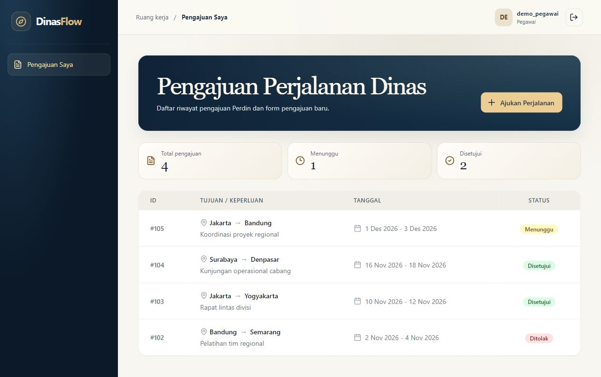
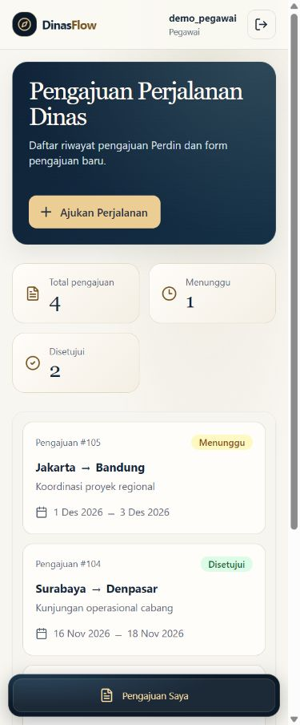
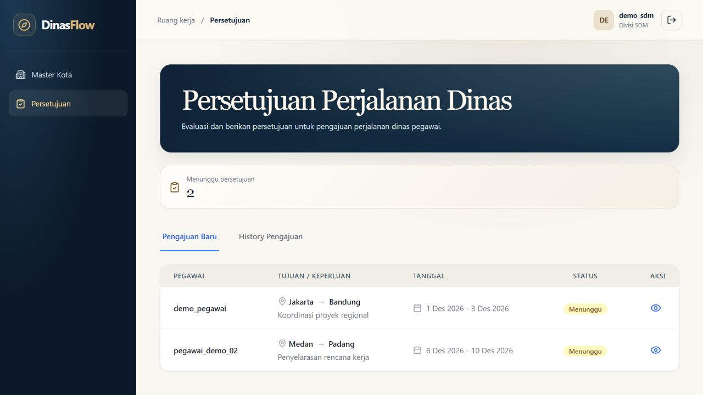
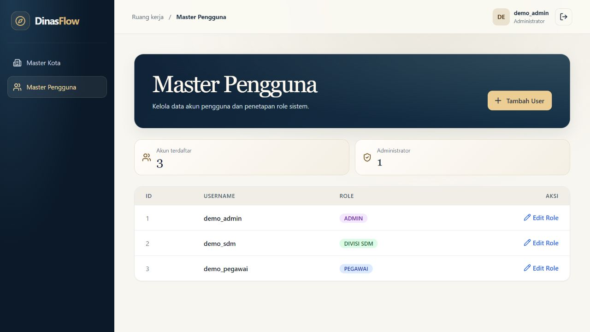

# DinasFlow


DinasFlow adalah aplikasi pengelolaan perjalanan dinas untuk pengajuan pegawai, peninjauan SDM, dan pengelolaan data oleh administrator. Aplikasi menghitung estimasi uang saku berdasarkan jarak antarkota dan klasifikasi wilayah.

**[Coba demo DinasFlow](https://dinasflow.rajuportofolio.web.id)**

## Akun demo

| Peran | Username | Kata sandi |
| --- | --- | --- |
| Admin | `demo_admin` | `DemoDinas2026!` |
| Divisi SDM | `demo_sdm` | `DemoDinas2026!` |
| Pegawai | `demo_pegawai` | `DemoDinas2026!` |

Demo menggunakan data bersama. Akun admin demo dapat mengubah akun dan data lain sehingga kredensial dan isi demo dapat berubah sewaktu-waktu. Gunakan data contoh saat mencoba aplikasi.

## Fitur

- **Pegawai** mengajukan perjalanan dengan tanggal, tujuan, serta kota asal dan tujuan, lalu memantau status pengajuan.
- **Divisi SDM** meninjau detail, jarak, durasi, dan estimasi uang saku sebelum menyetujui atau menolak pengajuan.
- **Admin** mengelola akun pengguna, peran, kata sandi, dan data kota. SDM juga dapat mengelola kota.
- **Perhitungan uang saku** memakai jarak garis lurus Haversine berdasarkan koordinat kota serta klasifikasi provinsi, pulau, dan tujuan luar negeri.
- **Antarmuka responsif** menyediakan kartu riwayat untuk layar ponsel dan animasi yang mengikuti preferensi pengurangan gerak.

## Tampilan aplikasi

Screenshot berikut diambil dari versi rebranding menggunakan data simulasi.

### Login


### Pengajuan pegawai





### Persetujuan SDM



### Pengelolaan pengguna



## Teknologi

- **Frontend:** React 19, TypeScript, Vite, Tailwind CSS, React Router, Axios, dan Lucide.
- **Backend:** Go, Gin, GORM, PostgreSQL, JWT, dan bcrypt.
- **Deployment:** Docker Compose dan Caddy.

Sesi menggunakan cookie HttpOnly dan disimpan di database. Pada mode produksi, cookie juga memakai atribut Secure.

## Menjalankan secara lokal

Persyaratan: Go 1.26.3 atau lebih baru, Node.js yang kompatibel dengan dependensi frontend, npm, dan PostgreSQL.

1. Clone repository dan masuk ke direktori proyek.

   ```bash
   git clone https://github.com/rajuputra/perdin-go-react.git
   cd perdin-go-react
   ```

2. Buat database PostgreSQL, salin `.env.example` menjadi `.env`, lalu isi variabel `DB_HOST`, `DB_PORT`, `DB_NAME`, `DB_USER`, dan `DB_PASSWORD`. Isi `JWT_SECRET` dengan nilai acak minimal 32 byte. Jangan gunakan kredensial demo sebagai secret aplikasi.

3. Jalankan backend dari root proyek.

   ```bash
   go run .
   ```

   Backend berjalan di port `8080` secara default dan melakukan migrasi tabel saat startup.

4. Pada terminal lain, jalankan frontend.

   ```bash
   cd perdin
   npm ci
   npm run dev
   ```

   Buka [http://localhost:3000](http://localhost:3000). Vite meneruskan permintaan `/api` ke backend lokal.

5. Untuk database baru tanpa administrator, buat akun awal dari root proyek. Contoh berikut menggunakan shell yang mendukung `read -s` dan tidak menampilkan kata sandi saat diketik.

   ```bash
   read -s -p "Kata sandi admin: " DINASFLOW_ADMIN_PASSWORD; echo
   printf '%s\n' "$DINASFLOW_ADMIN_PASSWORD" | ADMIN_USERNAME=admin go run . init-admin
   unset DINASFLOW_ADMIN_PASSWORD
   ```

   Kata sandi admin awal harus 12–72 byte. Setelah masuk sebagai admin, buat akun SDM dan pegawai melalui Master Pengguna, serta tambahkan minimal dua kota untuk mencoba pengajuan.

## Pemeriksaan

```bash
go test ./...
cd perdin
npm run build
npm run lint
```

Untuk konfigurasi Docker Compose, reverse proxy, backup, dan prosedur admin awal di server, lihat [panduan deployment](deploy/README.md).
